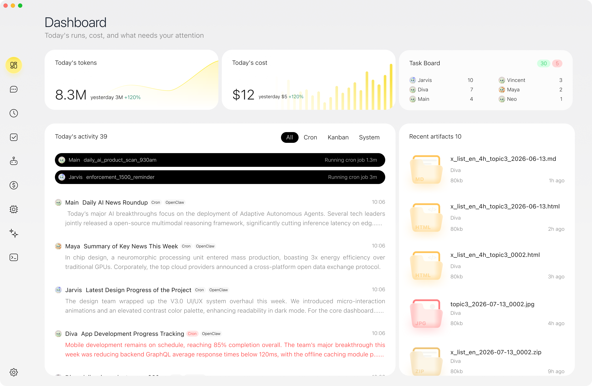
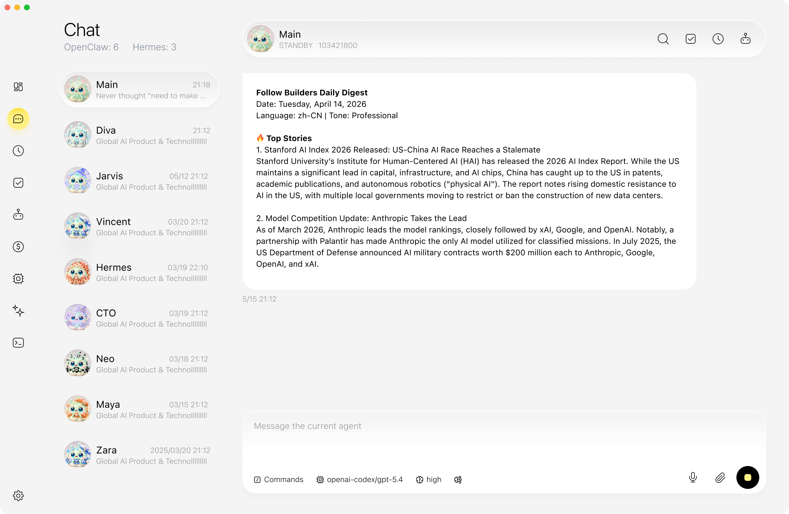
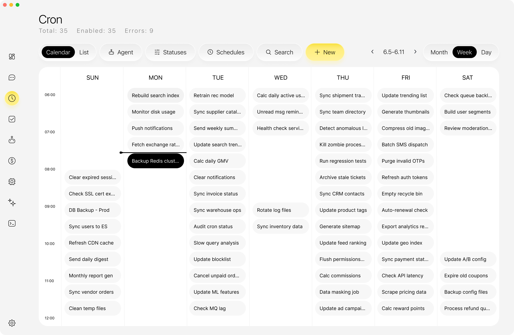
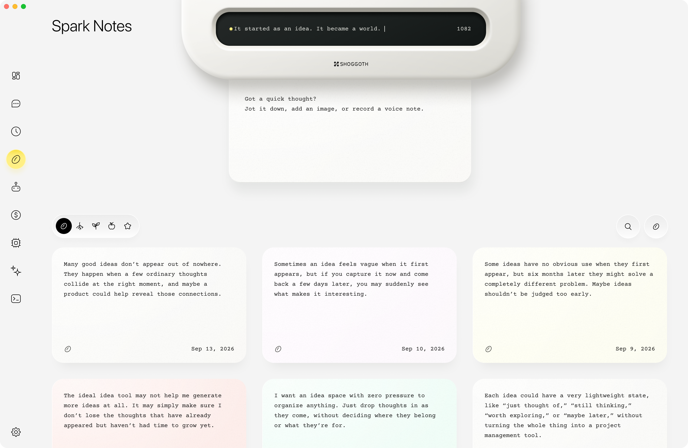

<p align="center">
  
</p>

<h1 align="center">Shoggoth</h1>

<p align="center"><strong>A local workspace for AI agents on macOS</strong></p>
<p align="center">Chat with your agents, bring them into one conversation, and schedule recurring work.</p>

<p align="center">
  <a href="https://github.com/ArronKong/Shoggoth/releases/latest"><strong>Download for macOS</strong></a>
  · <a href="#product-tour">Product tour</a>
  · <a href="#build-from-source">Build from source</a>
  · <a href="README.zh-CN.md">简体中文</a>
</p>

<p align="center">macOS 13+ · Apple Silicon and Intel · <a href="LICENSE">Apache-2.0</a></p>

<p align="center">
  <a href=".github/readme-assets/dashboard.png"></a>
</p>

## Get started

1. Open the [latest release](https://github.com/ArronKong/Shoggoth/releases/latest) and download the DMG for your Mac. In **About This Mac**, **Chip** means Apple Silicon (arm64); an Intel **Processor** means Intel (x64).
2. Open the DMG and drag Shoggoth into Applications.
3. In Shoggoth, configure a model and account in **Models**, then open **Chat**. To use an existing OpenClaw or Hermes installation, connect it in **Settings**.

## What you can do

- **Work with several agents.** Use individual chats for focused work, or enable group chat to bring multiple agents into one conversation.
- **Run recurring tasks.** Set a schedule and review past runs from the desktop.
- **Manage models and tools.** Configure models and accounts, connect supported runtimes, and manage skills and MCP connectors from the same app.

The desktop app runs a local agent service. Model requests and connected tools may use external services, depending on what you configure.

## Product tour

<table>
<tr>
<td width="33%" valign="top">
<a href=".github/readme-assets/chat.png"></a><br />
<strong>Chat</strong><br />
<sub>Switch between agents and revisit their conversations.</sub>
</td>
<td width="33%" valign="top">
<a href=".github/readme-assets/cron.png"></a><br />
<strong>Cron</strong><br />
<sub>See when recurring jobs are scheduled to run.</sub>
</td>
<td width="33%" valign="top">
<a href=".github/readme-assets/spark-notes.png"></a><br />
<strong>Spark Notes</strong><br />
<sub>Capture ideas and come back to them later.</sub>
</td>
</tr>
</table>

## Build from source

- macOS 13 or newer on Apple Silicon or Intel.
- Node.js 22.22.3 or newer and npm. The packaged app carries its own runtime.
- Internet access during dependency and pinned runtime downloads.
- Accounts and any external CLI/backend you choose to connect. They are not
  required to build the UI or run the isolated tests.

From the repository root:

```sh
npm ci
npm --prefix app/manage-ui ci
npm run prepare:runtimes
npm run build:manage
npm start
```

`prepare:runtimes` obtains the pinned Codex, Cua and offline E5 resources,
prepares SQLite binaries for both Mac architectures, and builds the local
workspace, Apple-device and media helpers. Downloads and extracted binaries
are verified against manifests under `build/`. It does not configure external
agents or sign in to an account. Generated resources live in `.vendor/`.
Do not commit that directory.

To work on the UI, run `npm --prefix app/manage-ui run dev` and, in a second
terminal, `npm run start:dev`. The desktop process supplies the local API.
To build ZIP archives containing the application:

```sh
npm run dist
```

The output is under `dist/`. Builds without a configured Developer ID and
notarization profile are **internal previews**. Public Mac binary distribution
requires Developer ID signing, notarization, Gatekeeper checks and validation
on a clean Mac account.

## Signed releases and automatic updates

Official builds check the public [GitHub Releases](https://github.com/ArronKong/Shoggoth/releases)
feed after launch and every six hours. A release must contain both macOS ZIPs
and `latest-mac.yml`; source archives alone cannot update the installed app.
Development, ad-hoc and internal preview builds deliberately keep the production
update channel disabled.

Follow the [release checklist](RELEASING.md) for every source update and signed
macOS release. It requires a fresh source export, a manual review of the complete
`public-source` tree for private or unnecessary files, license and CI checks,
Developer ID signing and notarization of both architectures, and verification
of a draft Release before publication. The current release path uses local
signing credentials and a native Intel runner to verify the draft.

The `Signed macOS release` GitHub Actions workflow is manual-only. It is an
optional path after end-to-end validation; the public repository must have
these Actions secrets before it can run:

- `MACOS_CERTIFICATE_BASE64`, `MACOS_CERTIFICATE_PASSWORD`, `MACOS_SIGNING_IDENTITY`
- `APPLE_API_KEY_BASE64`, `APPLE_API_KEY_ID`, `APPLE_API_ISSUER`, `APPLE_TEAM_ID`

Pushing a version tag does not automatically build or publish a release. The
first updater-capable signed build must be installed manually; later signed
releases can update it in place.

For each source update, run `npm run export:source -- /absolute/path/to/an-empty-directory`.
The export excludes internal development notes, Git history and retired plugin /
OpenConnector resources. Connections use the Service-managed MCP client and
its recommended-app catalog. Registry tools are installed only after the user
confirms their exact versions and launch settings. The file-hash manifest is
written beside the directory as `<directory>.manifest.json` for local verification.
Review and scan every export before updating the public repository.

## Integrations and data

Connect the local backends you need in Settings and configure models/accounts
in Models. OpenClaw and Hermes remain separate installations; follow their
upstream installation instructions. Local files, conversations and configuration
may contain private data. Never copy application data or credentials into a
public issue or repository.

Native **Claude Code integration is disabled in this release**, and the Claude
Agent SDK is not included in dependencies or packages. Existing account and
conversation data is preserved. Anthropic models accessed through a separately
configured backend are unaffected.


Desktop group drafts and original send records are stored in the private Electron
`userData/group-send-journal/journal.json` file. This client journal is separate
from the Service authority backup; include it in desktop data backups and
preserve unconfirmed entries during cache cleanup. Restart recovery checks the
original message ID without automatically resending it.

## Checks

```sh
npm --prefix app/manage-ui exec -- tsc --noEmit --project app/manage-ui/tsconfig.json
npm run build:manage
npm run release:metadata
npm run licenses:check
node scripts/third-party-licenses-unit.mjs
node scripts/desktop-app-update-unit.cjs
node scripts/app-update-release-contract-unit.cjs
node scripts/adhoc-sign-unit.cjs
node scripts/notarize-unit.cjs
node scripts/shoggoth-builtin-cli-profiles-unit.cjs
node scripts/runtime-cli-auth-unit.cjs
node scripts/shoggoth-runtime-adapter-registry-unit.cjs
node scripts/proxy-smoke.mjs
node scripts/proxy-chat-smoke.mjs
node scripts/hermes-start-smoke.cjs
node --test scripts/dependency-audit-policy-unit.cjs scripts/undici-security-regression.cjs
npm run audit:release
```

For a built candidate, run the package checks against its explicit output directory:

```sh
SHOGGOTH_SMOKE_DIST_DIR=/absolute/path/to/candidate npm run test:mcp-connectors:app -- --spike-arm64
```

Use `--spike-x64` for the Intel candidate; a formal release also requires native
Intel acceptance. Dependency audit applicability reviews are documented in
[RELEASING.md](RELEASING.md), with the original audit reports retained.

On macOS, after installing Electron and building the UI:

```sh
node_modules/.bin/electron scripts/ui-security-electron-smoke.cjs
```

These checks use fixtures and temporary local services. Tests that require real
accounts or mutate external backends are separate; see [contributing](CONTRIBUTING.md).
If a runtime download fails, rerun `npm run prepare:runtimes`; do not skip hash
checks. If Electron downloads need your configured HTTP(S) proxy, use
`ELECTRON_GET_USE_PROXY=1 npm ci`. After changing dependencies, install from both lockfiles and regenerate
release metadata before packaging.

## License

Shoggoth-authored code is available under the [Apache License 2.0](LICENSE).
See the [project notice](NOTICE) for the copyright statement and license scope.
Third-party code, fonts and bundled programs retain their original licenses.
See the [complete third-party notices](resources/legal/THIRD-PARTY-NOTICES.md),
[license index](resources/legal/third-party-index.json) and
[runtime source locations](resources/legal/RUNTIME-LICENSE-SOURCES.md).
The application includes these documents under `Contents/Resources/legal`.
