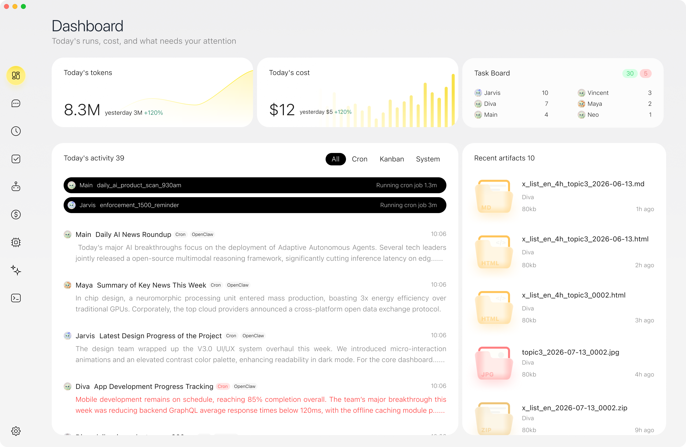
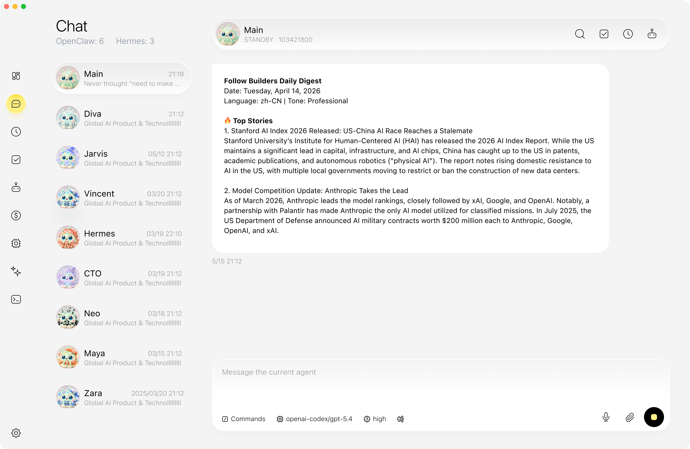
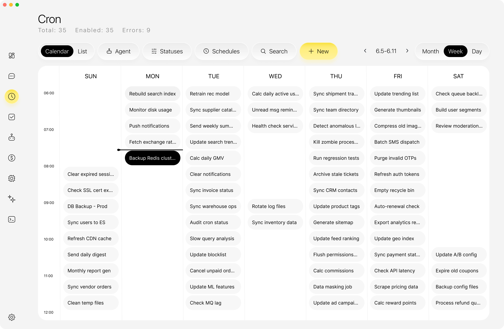
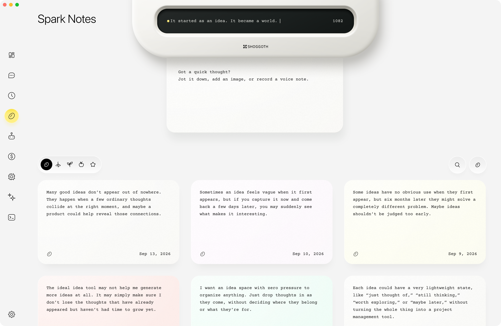

<p align="center">
  
</p>

<h1 align="center">Shoggoth</h1>

<p align="center"><strong>macOS 上的本地 AI Agent 工作台</strong></p>
<p align="center">和 Agent 对话，把多个 Agent 拉进同一个群聊，也能把重复工作设成定时任务。</p>

<p align="center">
  <a href="https://github.com/ArronKong/Shoggoth/releases/latest"><strong>下载 macOS 版</strong></a>
  · <a href="#产品导览">产品导览</a>
  · <a href="#从源码运行">从源码运行</a>
  · <a href="README.md">English</a>
</p>

<p align="center">macOS 13 或更新版本 · Apple 芯片与 Intel · <a href="LICENSE">Apache-2.0</a></p>

<p align="center">
  <a href=".github/readme-assets/dashboard.png"></a>
</p>

## 快速上手

1. 在[最新发布](https://github.com/ArronKong/Shoggoth/releases/latest)里下载对应的 DMG。打开「关于本机」：显示 Apple 芯片就选 arm64，显示 Intel 处理器就选 x64。
2. 打开 DMG，将 Shoggoth 拖入「应用程序」。
3. 在 Shoggoth 的「模型」页配置模型和账号，然后打开「聊天」。如果已经安装了 OpenClaw 或 Hermes，可以在「设置」里连接。

## 可以做什么

- **和多个 Agent 协作。** 在单聊里处理具体任务，也可以启用群聊，让多个 Agent 在同一个会话里协作。
- **安排定时任务。** 给重复工作设置执行时间，并在桌面应用里回看运行记录。
- **管理模型和工具。** 集中配置模型和账号、连接支持的运行时，并管理 Skills 和 MCP 连接器。

Agent 服务在本机运行。根据你的配置，模型请求和连接的工具可能访问外部服务。

## 产品导览

<table>
<tr>
<td width="33%" valign="top">
<a href=".github/readme-assets/chat.png"></a><br />
<strong>聊天</strong><br />
<sub>切换 Agent，回看各自的对话。</sub>
</td>
<td width="33%" valign="top">
<a href=".github/readme-assets/cron.png"></a><br />
<strong>定时任务</strong><br />
<sub>在周历上查看重复任务的执行时间。</sub>
</td>
<td width="33%" valign="top">
<a href=".github/readme-assets/spark-notes.png"></a><br />
<strong>灵感便签</strong><br />
<sub>随手记录想法，之后再回来整理。</sub>
</td>
</tr>
</table>

## 从源码运行

- **macOS 13 或更新版本**，支持 Apple 芯片和 Intel。
- 从源码开发需要 **Node.js 22.22.3 或更新版本**及 npm；打包后的应用自带所需运行时。
- 安装依赖和下载固定版本的运行时需要联网。
- 根据使用的功能，准备相应账号，以及需要连接的外部 CLI 或后端。仅构建界面、运行隔离测试时不需要登录这些账号。

下载或克隆仓库后，在项目根目录执行：

```sh
npm ci
npm --prefix app/manage-ui ci
npm run prepare:runtimes
npm run build:manage
npm start
```

`prepare:runtimes` 会下载固定版本的 Codex、Cua 和离线 E5 资源，准备两种 Mac 架构使用的 SQLite 原生模块，并构建本机工作区、Apple 设备及媒体 helper。下载文件与解压后的二进制会按照 `build/` 中的清单校验。

这些步骤不会安装、配置外部代理，也不会自动登录账号。下载生成的文件位于 `.vendor/`，无需提交到仓库。

## 开发与构建

开发前端时，在一个终端中启动界面开发服务器：

```sh
npm --prefix app/manage-ui run dev
```

再在另一个终端的项目根目录启动桌面应用，由它提供本地 API：

```sh
npm run start:dev
```

构建包含桌面应用的 ZIP 安装包：

```sh
npm run dist
```

构建产物位于 `dist/`。未配置 Developer ID 和公证凭据时，生成的包用于内部预览。正式向 macOS 用户分发前，需要完成签名、公证、Gatekeeper 检查和干净 Mac 账户下的验证。

## 正式发布与自动更新

正式构建会在启动后及每六小时检查一次公开的 [GitHub Releases](https://github.com/ArronKong/Shoggoth/releases)。每个版本必须同时上传 Apple Silicon、Intel 两个 macOS ZIP 和 `latest-mac.yml`；只上传源码压缩包不能更新已安装的 App。开发版、ad-hoc 和内部预览包不会连接正式更新通道。

每次更新源码和发布正式安装包，都要执行[发布检查清单](RELEASING.md)：从新目录导出源码，人工审核 `public-source` 的完整文件树及隐私、许可证和 CI 检查，完成两个架构的 Developer ID 签名与公证，并在草稿 Release 中验收后公开。目前正式发布使用本机签名凭据，草稿还需经原生 Intel runner 验收。

`Signed macOS release` GitHub Actions 工作流仅供手动触发；完整端到端实测通过后才能作为另一条正式发布路径。公开仓库需先配置以下 Secrets：

- `MACOS_CERTIFICATE_BASE64`、`MACOS_CERTIFICATE_PASSWORD`、`MACOS_SIGNING_IDENTITY`
- `APPLE_API_KEY_BASE64`、`APPLE_API_KEY_ID`、`APPLE_API_ISSUER`、`APPLE_TEAM_ID`

推送版本标签不会自动打包或发布。第一个带自动更新能力的正式签名版本仍需手动安装；后续正式签名版本才可以原位自动更新。

## 后端连接与数据

在「设置」中连接需要的本地后端，在「模型」中配置模型和账号。OpenClaw 与 Hermes 需要单独安装，请按各自上游项目的说明配置。

当前版本暂时停用 **原生 Claude Code 连接**，依赖和安装包中不包含 Claude Agent SDK。已有账号与对话数据保留；通过其他已配置后端访问的 Anthropic 模型不受此限制。

本地配置、会话和文件可能包含私人数据。提交 Issue 或分享项目文件时，请先移除账号凭据和私人内容。


桌面群聊草稿和原始发送记录保存在 Electron 私有 `userData/group-send-journal/journal.json`。
这份客户端日志不在 Service 权威数据备份中，备份桌面数据时需一并保存；清理缓存时保留未确认记录。
重启恢复只按原消息 ID 核对，不自动重发。

## 常用检查

在项目根目录运行：

```sh
npm --prefix app/manage-ui exec -- tsc --noEmit --project app/manage-ui/tsconfig.json
npm run build:manage
npm run release:metadata
npm run licenses:check
node scripts/third-party-licenses-unit.mjs
node scripts/desktop-app-update-unit.cjs
node scripts/app-update-release-contract-unit.cjs
node scripts/adhoc-sign-unit.cjs
node scripts/notarize-unit.cjs
node scripts/shoggoth-builtin-cli-profiles-unit.cjs
node scripts/runtime-cli-auth-unit.cjs
node scripts/shoggoth-runtime-adapter-registry-unit.cjs
node scripts/proxy-smoke.mjs
node scripts/proxy-chat-smoke.mjs
node scripts/hermes-start-smoke.cjs
node --test scripts/dependency-audit-policy-unit.cjs scripts/undici-security-regression.cjs
npm run audit:release
```

构建候选包后，指定其准确产物目录执行包验收：

```sh
SHOGGOTH_SMOKE_DIST_DIR=/absolute/path/to/candidate npm run test:mcp-connectors:app -- --spike-arm64
```

Intel 候选使用 `--spike-x64`，正式发布还须经原生 Intel 环境验收。依赖审计的范围复核及原始报告保留要求见 [RELEASING.md](RELEASING.md)。

在 macOS 上安装 Electron 并完成界面构建后，还可以运行窗口安全检查：

```sh
node_modules/.bin/electron scripts/ui-security-electron-smoke.cjs
```

以上检查使用测试数据和临时本地服务。需要真实账号或会修改外部后端的测试，应在单独的测试环境中运行。参与开发前请阅读[贡献说明](CONTRIBUTING.md)。

如果运行时下载失败，可以重新执行 `npm run prepare:runtimes`，不要跳过文件校验。如果 Electron 下载需要使用已配置的 HTTP(S) 代理，可以执行 `ELECTRON_GET_USE_PROXY=1 npm ci`。修改依赖后，应按两份锁文件重新安装，并在打包前重新生成发布元数据。

## 导出用于发布的源码

每次更新公开源码时，都要导出到一个新的空目录：

```sh
npm run export:source -- /absolute/path/to/an-empty-directory
```

导出会排除内部开发记录、原仓库 Git 历史及已退役的插件 / OpenConnector 资源。连接器使用 Service 托管的 MCP 客户端和推荐应用目录；Registry 工具在用户确认精确版本与启动设置后安装。文件哈希清单保存在导出目录旁边，名称为 `<directory>.manifest.json`，用于本地核对。每次更新公开仓库前，都要检查并扫描导出的内容。

## 许可证

Shoggoth 自有代码采用 [Apache-2.0 许可证](LICENSE)，版权与适用范围见[项目声明](NOTICE)。第三方代码、字体和随包程序保留各自原有许可证。

相关来源、版权和完整许可文本见：

- [第三方声明](resources/legal/THIRD-PARTY-NOTICES.md)
- [许可证索引](resources/legal/third-party-index.json)
- [运行时源码来源](resources/legal/RUNTIME-LICENSE-SOURCES.md)

打包后的应用也会在 `Contents/Resources/legal` 中包含这些许可材料。
